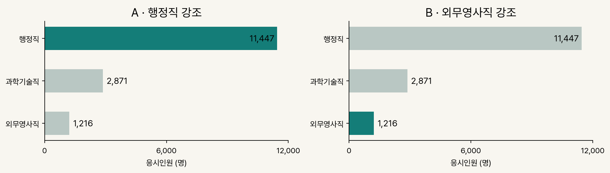
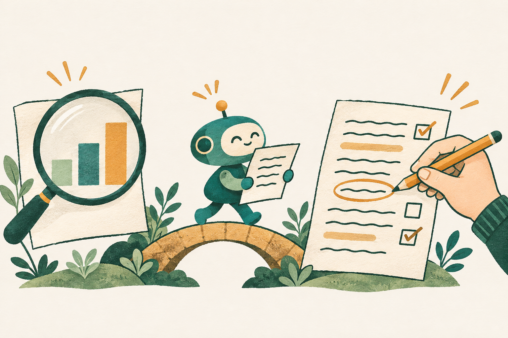

# AI와 함께 쓰고, 우리 판단으로 완성하기

  

- 세종대 AI 글쓰기 특강 자료; 하나의 팀 보고서를 질문·메모에서 근거·표현·퇴고·공유까지 연결.
- 중심 질문 = **AI가 만든 글을, 어떤 근거와 선택을 거쳐 우리 글로 받아들일 것인가?**
- 바로 보기 = [슬라이드](slides/sejong-ai-writing.html) · [PDF](slides/sejong-ai-writing.pdf) · [실습 카드](handout/prompts.html) · [데모 안내](demo/README.md).

## AI 글쓰기란 무엇인가

- 이 강의의 정의 = 사람이 질문·독자·목적을 정하고, AI의 생성·정리 능력을 활용해 근거 있는 글을 구성하고 검토·수정하는 과정.
- 저자의 일 = 무엇을 묻고 무엇을 주장할지 결정, 근거와 표현 선택, 독자에게 미칠 영향과 공유 책임 판단.
- AI의 일 = 메모에서 문장 후보 생성, 자료 정리, 표·차트 제작, 수정안 제시와 대조 보조.
- 완성의 기준 = 글쓴이가 채택한 문장과 근거를 설명하고, 확인한 사실과 아직 모르는 것을 구분할 수 있는 상태.

### 디지털 글쓰기에서 달라지는 것

- 표현의 범위 = 문단·표·차트·보고서·팀 메시지; 같은 내용을 독자와 쓰임에 맞게 연결.
- 작업의 연결 = 원자료 → 정리한 표 → 시각화 → 본문 → 공유문; 숫자와 의미를 단계마다 대조.
- 수정 가능한 결과 = 편집 원고·엑셀·코드·출처 보관; 자료나 판단이 바뀌면 결과를 다시 만들고 재검토.
- 남겨야 할 기록 = 처음 질문, 사용한 근거, 고른 표현과 이유, AI가 도운 일, 사람이 확인한 일.

## 어떤 통찰을 가져야 하는가

### 질문이 글의 방향을 정함

- ‘어느 분야가 인기인가’라는 질문에는 인기의 뜻과 비교 기준을 정하는 판단이 포함됨.
- ‘보고서 써줘’에 독자·메모·자료·금지 사항을 더하는 일 = 글의 목적과 허용 범위를 구체화하는 과정.
- 초안 검토의 첫 기준 = 처음 품었던 질문과 자기 생각이 글에 남아 있는지 확인.

### 같은 사실도 표현에 따라 다르게 읽힘

- 위 두 차트 = 숫자·축·순서·단위 동일, 강조할 분야만 변경한 강의 예제.
- 표현의 선택 = 제목·색·순서·생략으로 독자의 주의를 어디에 둘지 결정하는 일.
- 필요한 질문 = 무엇이 먼저 보이며, 무엇이 덜 보이고, 그 선택이 우리 글의 목적에 맞는가?

### 관찰한 사실과 해석의 범위를 구분함

- 확인 가능한 사실 = 세 분야 중 행정직의 응시인원이 11,447명으로 가장 많음; [자료·출처](demo/cases/d-grade7/SOURCE.md).
- 추가 확인이 필요한 해석 = ‘가장 인기 있다’, ‘사람들이 더 선호한다’, ‘이런 이유로 선택했다’는 주장.
- 결론의 구조 = **기준 + 확인한 숫자 + 자료의 한계**; 선택 이유와 선호는 별도 근거 필요.

### 생성·점검·승인을 구분함

- 초안 생성 = 검토할 후보 확보; AI의 자동 점검 = 수행한 범위의 검사 결과.
- 사람 확인 = 원문·숫자·표현·이용 조건을 직접 검토한 항목만 기록; 나머지는 미확인 유지.
- 퇴고 = 자기 뜻을 살리는 문장 선택·수정; 공유 = 확인 상태와 다음 행동을 독자·팀원에게 전달.

## 본 강의에서 얻어갈 점

- 요청 설계 = 역할·독자, 할 일·금지, 입력·출력 예, 참고자료를 담아 작업 범위 전달.
- 근거 읽기 = 원자료·표·차트·문장을 오가며 같은 사실을 말하는지 확인.
- 표현 판단 = 차트의 강조와 문장의 해석을 목적에 맞게 선택하고 이유 설명.
- 자기 글로 수정 = 메모에 없던 주장과 흐려진 뜻을 찾아 고친 문장·이유 기록.
- 협업으로 연결 = 결론·한계·확인할 일·담당할 일을 담아 팀 공유 초안 작성.

## 슬라이드에서 보여주고자 하는 점

  

- 하나의 팀 과제를 끝까지 유지 = 메모·서론·표·차트·결론·팀 채팅이 같은 질문에 어떻게 답하는지 관찰.
- AI와 사람의 역할을 장면마다 구분 = 후보를 만드는 일과 채택·확인·승인하는 일의 주체 확인.
- 표와 차트를 본문에 연결 = 비교 목적과 주목할 수치를 설명하고, 표현이 해석에 미치는 영향 확인.
- 시작과 끝을 같은 팀 채팅방으로 연결 = 글의 완성을 동료의 검토·수정·다음 행동으로 이어지는 협업으로 이해.

## 실습과 데모에서 보여주고자 하는 점

### 채팅 실습 · 선택과 수정의 경험

- [카드 1](handout/practice.md) · 메모 → 서론 = 살릴 문장과 고칠 문장을 골라 자기 관심 유지.
- 카드 2 · 자료 → 표·차트·문장 = 같은 숫자의 표현을 비교하고 자료 밖의 주장 점검.
- 카드 3 · 초안 → 퇴고 = 근거 없는 주장 수정, AI의 기여와 사람의 확인 상태 기록.
- 팀 메시지 · 보고서 → 공유 초안 = 결론·숫자·모르는 것·다음에 확인할 일을 짧게 전달.

### 코딩 에이전트 데모 · 글쓰기 과정을 파일로 연결

- [데모 요청문](demo/ONESHOT_PROMPT.md) = 자료 확보 → 표 정리 → 두 차트 비교 → 보고서 → 대조 → 사람 후속 작업을 하나의 작업 지시로 연결.
- 준비된 수집·제작 코드 사용 공개; 실제 사용 원자료·출처·보관본 여부와 완료하지 못한 일 기록.
- 원본·편집 가능한 엑셀·보고서 원고·HTML·점검 기록·후속 체크리스트 생성; 결과 사이의 근거 추적 가능.
- 핵심 관찰 = 파일 생성 뒤에도 사람이 확인·판단·수정·재대조·승인할 일이 남음; [후속 워크플로](demo/ONESHOT_WORKFLOW.md)로 연결.
- 범위 = 기본 실습은 응시인원 비교에 집중; 원샷 보고서의 경쟁률·선택 기준 비교는 심화 자료로 구분.

### 다음 글에서도 이어갈 습관

- 시작 전 = 누구에게 무엇을 설명할지, 가진 자료로 어디까지 답할 수 있는지 적기.
- 생성 후 = 원문을 열고 숫자·인용·추가 주장을 대조, 자기 뜻과 다른 표현 수정.
- 공유 전 = 확인한 것·미확인·선택 이유 기록, 실제 공유 주소와 다음 행동 확인 후 직접 승인·전송.

본문 슬라이드 24장 요약 펼치기

## 슬라이드별 찾아보기

- 기준 = [슬라이드 원고](slides/sejong-ai-writing.qmd)의 순서; 표지와 1·2부 구분 장을 제외한 본문 24장.
- 표지 · AI와 함께 팀 보고서 쓰기 = 질문 설정 → 자료 대조 → 우리 글로 수정·공유.

### 도입 · 경험에서 팀 과제로

- 01 · 오늘, 어떤 AI를 쓰고 있나요? = 청중의 사용 경험 확인, 대화형 AI와 파일을 다루는 AI 소개.
- 02 · 시작은 우리 팀 채팅방에서 = 가상 팀의 ‘7급 공채에서 어느 분야가 인기인가’라는 질문과 일반 독자 설정.
- 03 · 오늘 할 일은 한 편의 보고서를 완성하는 거예요 = 요청 구체화, 자료·글 대조, 선택 기록을 학습 목표로 연결.

### 1부 · 질문에서 초안으로

- 04 · AI는 무엇을 돕고, 우리는 무엇을 고를까요? = AI는 후보·정리·수정을 보조, 사람은 질문·근거·공유 결정.
- 05 · 먼저, 우리 팀이 궁금한 것을 적어봐요 = 관심과 들은 이야기를 메모하고 보고서의 출발점으로 유지.
- 06 · “보고서 써줘”에 무엇을 더할까요? = Identity·Instructions·Examples·Context로 요청 구체화.

### 1부 · 자료를 글의 근거로

- 07 · 표·차트를 본문에서 어떻게 소개할까요? = 비교 목적 → 표의 수치 → 차트가 보여 줄 차이를 본문에 연결.
- 08 · 필요한 두 칸부터 읽어봐요 = 분야·응시인원 확인; 실제 시험을 본 인원과 접수·지원 인원 구분.
- 09 · 강조만 바꿔도 다르게 읽혀요 = 같은 숫자·축·순서·단위에서 강조색이 바꾸는 관점 비교.
- 10 · 응시인원이 많으면, 인기가 높은 걸까요? = 인원 비교는 관찰, 인기·선호·선택 이유는 추가 기준과 근거가 필요한 해석.

### 1부 · 공유 전 확인과 기록

- 11 · 공유하기 전에 세 가지를 확인해봐요 = 원문 출처·이용 조건·우리 판단 확인; AI의 재답변도 검토 대상.
- 12 · 만든 일과 확인한 일을 나눠 기록해요 = 단계별 AI 기여·사람의 선택과 확인 구분; 미확인은 그대로 기록.

### 2부 · 같은 질문으로 직접 써보기

- 13 · 카드 1 · 메모로 서론 만들기 = 초안에서 살릴 문장·고칠 문장을 고르고 이유 기록.
- 14 · 카드 2 · 표·차트·문장 대조하기 = 세 숫자·축·순서·단위와 표 밖의 주장 점검.
- 15 · 전달하려는 내용에 맞게 차트의 초점을 정해요 = 수치 일치·전달 목적·빠진 정보를 살펴 강조 선택.
- 16 · 카드 3 · 우리 뜻으로 고쳐 완성하기 = 메모에 없던 주장·흐려진 뜻 수정; 전체 실습은 수업 뒤 이어가기.
- 17 · 직접 해보기 = QR의 카드 1→2→3을 같은 채팅에서 사용하고 AI 문장을 우리 글에 맞게 수정.

### 2부 · 코딩 에이전트 시연과 결과 검토

- 18 · 코딩 에이전트에 작업 방식을 지시해요 = 원본 확보→표→차트→보고서→대조 지시; 준비된 수집·제작 코드 사용 공개.
- 19 · 파일이 생겼다고, 검토가 끝난 것은 아니에요 = 원본·엑셀·초안·과정 기록 검토 후 판단→수정→재대조→승인.
- 20 · 도구가 달라도, 우리가 할 일은 이어져요 = 채팅과 폴더 작업 모두 맥락 제공→요청→확인·수정→다음 작업에 기록.

### 2부 · 결론과 협업, 다음 글쓰기

- 21 · 우리 질문에 답하는 문장인지 다시 읽어봐요 = 응시인원 기준 행정직 11,447명이라는 관찰과 선호·선택 이유의 한계 함께 제시.
- 22 · 마지막은, 같은 팀 채팅방으로 = 결론·아직 모르는 것·팀원이 할 일을 담은 공유 초안 작성.
- 23 · 다음 과제까지 가져갈 기록 세 가지 = 질문·메모, 자료·확인, 선택·수정 기록 보관.
- 24 · 글은 AI가 썼는데, 판단은 누가 한 거죠? = 채택한 표현·확인한 근거·독자에게 미칠 영향 점검; 강의 자체의 제작·확인 상태 공개.

## 슬라이드 보는 방법

- 온라인 = [강의 슬라이드](https://joygram.github.io/SejongLecture/); 첫 화면에서 슬라이드로 이동.
- 로컬 = 저장소 다운로드 후 [슬라이드 HTML](slides/sejong-ai-writing.html)을 브라우저로 열기; `slides/` 폴더 전체 유지.
- 이동 = 빈 화면 클릭으로 다음 장, Shift+클릭 또는 마우스 오른쪽 클릭으로 이전 장.
- PDF = [슬라이드 PDF](slides/sejong-ai-writing.pdf) 다운로드 후 복습·인쇄.
- 열람·기본 실습 = Python·Quarto 설치 불필요; 제작·재실행 환경은 아래 실행 항목 참고.

## 실습 시작

- 준비 = 평소 쓰는 AI 채팅 열기 → [학생용 프롬프트 카드](handout/prompts.html)를 브라우저로 열기.
- 온라인 카드 = [학생 페이지](https://joygram.github.io/SejongLecture/handout/prompts.html); 입력 원문 = [실습지](handout/practice.md).
- 진행 = 같은 채팅에 카드 1 → 카드 2 순서로 입력; 카드 3은 수업 뒤 이어서 실습.
- 기록 = AI 답에서 살릴 문장·바꿀 문장과 직접 확인한 숫자·출처 구분.

### 카드별 할 일

- 카드 1 · 서론 = 팀 메모로 첫 문단 생성 → 메모에 없는 사실 확인 → 살릴 문장·바꿀 문장 선택.
- 카드 2 · 데이터 = 제공된 세 분야 응시인원으로 세 문장·차트 A/B 요청 → 표·차트·문장 숫자 대조 → 강조할 관점 선택.
- 카드 3 · 퇴고 = 앞선 결과를 보고서 초안으로 묶기 → 근거 없는 주장 수정 → AI·사람의 작업과 사람 미확인 항목 기록.
- 마무리 · 공유 = 실습지의 마지막 요청으로 팀 채팅 3줄 초안 생성 → 결론·숫자·남은 확인 검토 → 실제 주소 확인 후 사람이 직접 공유.

### 강사 시연·추가 실습

- 강사 진행 = [시연 대본](demo/README.md); 코딩 에이전트·Quarto 구간은 강사 시연.
- 원샷 재현 = [학생용 요청문](demo/ONESHOT_PROMPT.md)과 [실행 워크플로](demo/ONESHOT_WORKFLOW.md) 확인 후 코딩 에이전트에서 실행; 매번 새 결과 폴더 생성.
- 생성 뒤 = 결과 폴더의 `NEXT_STEPS.md`에 따라 원자료·출처 확인 → 해석 결정 → 우리 글로 수정 → 재생성·재대조 → 사람 승인·공유.
- 도구별 활용 = [환경 안내](handout/tool-workflows.md), 문체 입력 = [스타일 템플릿](demo/REPORT_STYLE_TEMPLATE.txt).

## 구성

- `slides/` = Quarto revealjs 슬라이드, 발표자 노트·노출 목적·판단 질문 = 로컬 워크벤치
- `handout/prompts.html` = 학생 페이지 (QR = https://joygram.github.io/SejongLecture/handout/prompts.html, 생성 = python slides/workbench.py qr, PDF = python slides/workbench.py pdf)
- `handout/practice.md` = 학생 실습지
- `demo/README.md` = 같은 팀 리포트를 완성·공유하는 2부 시연 대본
- `demo/oneshot.py` = 준비된 수집·제작 코드; 강사 시연에서 사용 사실 공개, 실행 뒤 사람이 결과 검토
- `demo/report_workflow.py` + `demo/report-story.qmd` = 보관 CSV 재편집 예제, 원샷 신규 수집과 구분
- `demo/pipeline.py` + `demo/cases.json` = 수집 → 점검 → 사람 판정 → 시트·리포트
- `demo/cases/<사례>/` = raw 원본, data.csv, SOURCE.md, CHECK.md, DECISIONS.md, sheet.xlsx

## 실행

- `python demo/pipeline.py fetch all` → `inspect all` → 각 DECISIONS.md 작성 → `build all`
- `quarto render slides/sejong-ai-writing.qmd`
- 필요: Quarto, Python + pandas·matplotlib·openpyxl·pdfplumber·jupyter

## 슬라이드 제작·검수

- 워크벤치 = `slides/workbench/README.md`, 재사용 제작 프롬프트 = `slides/SLIDE_PROMPT.txt`.
- `python slides/workbench.py build` → `check` → `serve`.
- 청중용 HTML에는 발표자 노트 미포함, 발표자 노트는 로컬 워크벤치에서 확인.

## 강연 주제 태그

- AI 글쓰기 · 디지털 글쓰기 · 생성형 AI 교육 · 프롬프트 · 데이터 리터러시 · 보고서 작성 · 데이터 시각화 · AI 윤리.

## 강연 문의

- 강연·워크숍이 필요한 경우 [joygram@gmail.com](mailto:joygram@gmail.com)으로 주제·대상·희망 일정을 보내 주세요.

---

- 역할 분담 = 강연자: 주제·목표·구성 결정과 내용·표현 수정 지시 / AI: 초안·자료 정리, 코드·차트·시각 자료 구현과 자동 점검 보조.
- 이 저장소의 강연과 강의 자료는 AI와 함께 만들었습니다.
