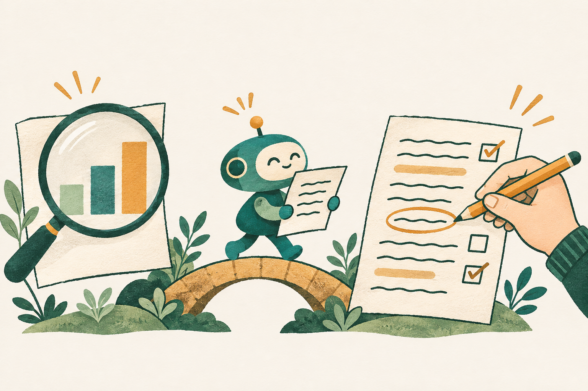

```{python}
from pathlib import Path
import pandas as pd
import matplotlib.pyplot as plt
from matplotlib.font_manager import FontProperties
from matplotlib.ticker import StrMethodFormatter
from fontTools.ttLib import TTFont
Path('.workbench').mkdir(exist_ok=True)
font_path = Path('.workbench/Pretendard.ttf')
font = TTFont('assets/fonts/PretendardVariable.woff2')
font.flavor = None
font.save(font_path)
chart_font = FontProperties(fname=str(font_path))
plt.rcParams['font.family'] = chart_font.get_name()
from matplotlib import font_manager
font_manager.fontManager.addfont(str(font_path))
exam = pd.read_csv('../demo/cases/d-grade7/data.csv')
groups = exam[exam['level'] == '직군 계'].copy().sort_values('sat', ascending=False)
assert groups['sat'].notna().all()
```


## 오늘, 어떤 AI를 쓰고 있나요? {.opening-poll}

:::: {.tile-grid .three}

::: {.tile}
[써본 경험]{.tile-title}

과제나 공부에서 어떤 도움을 받았나요?
:::

::: {.tile}
[대화하는 AI]{.tile-title}

ChatGPT · Gemini에서 글을 부탁해 봤나요?
:::

::: {.tile}
[파일을 다루는 AI]{.tile-title}

Claude Code · Codex로 파일을 만들거나 고쳐 봤나요?
:::
::::

::: notes
보여주는 이유: 청중 경험을 확인하고 두 작업 방식 소개
생각할 질문: 내가 AI에 맡겨 본 일은 무엇인가요?
00–01′. 제품 순위·요금·설치 설명 없음. 이름은 도구 예시로만 제시.
:::


## 시작은 우리 팀 채팅방에서 {.story-opening}

[수업용 가상 팀 과제예요]{.story-label}

:::: {.story-layout}
::: {.story-chat}
::: {.chat-bubble .student}
<span class="chat-who">지민</span>

“2026년 국가공무원 7급 시험 현황으로 팀 보고서 쓰자.”
:::
::: {.chat-bubble .assistant}
<span class="chat-who">나</span>

“7급은 어느 분야가 인기야? 그걸로 보고서 써보자.”
:::
::: {.chat-bubble .friend}
<span class="chat-who">수아</span>

“행정직에 사람이 많다던데, 거기가 제일 인기 있는 거 아냐?”
:::
:::
::: {.story-art .assignment-card}
{.scene-illustration}

**이번 보고서의 질문**

올해 7급 공채는 어느 분야가 인기 있을까요?

[일반 독자에게 설명할 팀 보고서]{.story-label}
:::
::::

::: notes
보여주는 이유: 처음 질문·독자·AI 도우미를 같은 팀 과제에 연결
생각할 질문: 일반 독자에게 어떤 내용을 소개하려 하나요?
01–02′. 등장인물·대화는 가상. 보고서의 독자는 일반 독자, 채팅 참여자는 공동 작성자.
:::


## 오늘 할 일은 한 편의 보고서를 완성하는 거예요 {.lecture-goals}

::: {.flow-line}
[질문·메모]{} [서론 초안]{} [표·차트·문장]{} [수정·공유]{}
:::

:::: {.tile-grid .three}

::: {.tile}
[요청을 구체적으로]{.tile-title}

맥락·역할·제약·예시를 담아요.
:::

::: {.tile}
[자료와 글을 대조]{.tile-title}

숫자와 표현이 맞는지 살펴요.
:::

::: {.tile}
[우리 선택을 기록]{.tile-title}

고친 문장과 남은 확인을 남겨요.
:::
::::

::: notes
보여주는 이유: 학습 목표와 전체 흐름 연결
생각할 질문: 어느 단계에서 우리가 선택해야 하나요?
02–04′. 모든 예시의 질문·자료·독자를 동일하게 유지. 실습 카드 1·2는 강의 중, 카드 3은 집에서 수행.
:::


# 1부 · 질문에서 초안으로


::: notes
보여주는 이유: 이론 구간 시작
생각할 질문: AI에게 무엇을 부탁할까요?
04′. 
:::


## AI는 무엇을 돕고, 우리는 무엇을 고를까요? {.paper-notes}

:::: {.before-after}
::: {.ba-cell}
**AI에게 부탁해요**

메모에서 서론 후보 만들기<br>자료를 표와 차트로 정리하기<br>뜻이 흐려지는 문장 짚기
:::
::: {.ba-cell}
**우리 팀이 결정해요**

무슨 질문에 답할지<br>어떤 근거와 표현을 쓸지<br>무엇을 확인하고 공유할지
:::
::::

**길잡이와 판단은 사람이 해요.**

::: notes
보여주는 이유: AI 도움과 사람의 판단을 구체적으로 구분
생각할 질문: 지금 우리 팀에 필요한 도움은 무엇인가요?
04–07′. 프레젠테이션은 AI로 표기. 역할 예시는 권한·책임 위임을 뜻하지 않음.
:::


## 먼저, 우리 팀이 궁금한 것을 적어요 {.paper-notes}

> 올해 7급 공채는 어느 분야가 인기 있을까?<br>
> 행정직에 사람이 많다던데.<br>
> 자료를 찾아서 인기 있는 분야를 소개하는 보고서를 쓰고 싶다.

[수업용 팀 메모예요]{.story-label}

**아직은 궁금한 것과 들은 이야기뿐이에요. 어디서부터 써볼까요?**

::: notes
보여주는 이유: 일반적인 관심과 막연한 생각에서 출발하기
생각할 질문: 우리 팀의 관심이 드러나는 문장은 무엇인가요?
07–12′. 새 경험·감정·동기를 AI가 대신 만들어 넣지 않음. 하나의 질문을 서론·표·차트·결론·공유까지 유지.
:::


## “보고서 써줘”에 무엇을 더할까요? {.paper-notes}

:::: {.before-after}
::: {.ba-cell}
**짧은 요청**

“2026년 7급 공채 현황으로 보고서의 서론을 써줘.”
:::
::: {.ba-cell}
**우리 팀의 요청**

“너의 역할은 일반 독자를 위한 보고서 작성 도우미다. 아래 메모를 바탕으로 주제를 소개하는 서론 한 문단을 작성하라.”
:::
::::

**결과에 질문·독자·우리 메모가 남아 있나요?**

::: notes
보여주는 이유: 좋은 요청을 만능 주문으로 제시하지 않고 필요한 맥락을 확인
생각할 질문: 빠진 조건을 하나만 보탠다면 무엇일까요?
12–16′. 예시 요청이며 실제 AI 응답 비교는 2부에서 수행. 두 답의 좋고 나쁨을 미리 판정하지 않음.
:::


## AI에 줄 작업 지침을 네 가지로 정해요

:::: {.tile-grid .four}

::: {.tile}
[맥락 · 누구에게 왜]{.tile-title}

7급 시험 현황이 궁금한 일반 독자를 위한 보고서다.
:::

::: {.tile}
[역할 · 어떤 도움]{.tile-title}

너의 역할은 보고서 작성 도우미다. 작성자의 메모를 글로 정리하라.
:::

::: {.tile}
[제약 · 지킬 조건]{.tile-title}

메모의 관심사를 유지하고, 주제와 목적이 드러나는 서론 한 문단을 작성하라.
:::

::: {.tile}
[예시 · 원하는 문장]{.tile-title}

“올해 7급 공채에서는 어떤 분야에 관심이 모였을까?”
:::
::::

[이 네 묶음은 이번 강의에서 쓰는 실무 체크리스트예요.]{.reference-note}

::: notes
보여주는 이유: 요청의 네 요소를 실제 한 요청에 연결
생각할 질문: 우리 요청에서 빠진 조건은 무엇인가요?
16–20′. 학술 표준·특정 연구자의 네 요소 이론으로 귀속하지 않음. 역할만 바꾸면 결과가 좋아진다고 보장하지 않음.
:::


## 표·차트를 본문에서 어떻게 소개할까요? {.evidence-intro}

:::: {.evidence-layout}
::: {.evidence-examples}
::: {.evidence-example}
[표를 넣기 전에 · 무엇을 비교하는지]{.evidence-label}

“분야별 응시 규모를 비교하기 위해, 2026년 7급 공채 응시인원을 **표 1**에 정리했어요.”
:::
::: {.evidence-example}
[표를 읽은 뒤 · 주목할 수치를 짚기]{.evidence-label}

“**표 1**에서 행정직은 11,447명으로, 세 분야 중 응시인원이 가장 많아요.”
:::
::: {.evidence-example}
[차트를 넣을 때 · 전달하려는 모습 연결하기]{.evidence-label}

“분야 사이의 규모 차이가 드러나도록 **그림 1**의 가로 막대차트로 나타냈어요.”
:::
:::
::: {.evidence-art}


**표·차트를 붙인 자리에서, 무엇을 봐야 하는지 설명해요.**
:::
::::

::: notes
보여주는 이유: 표·차트를 실제 본문에 도입하고 근거로 활용하는 문장 제시
생각할 질문: 이 표와 차트를 왜 이 문장 옆에 넣나요?
20–21′. 세 문장은 수업용 작성 예시. 표 앞에는 비교 목적·자료 범위, 뒤에는 글에서 주목할 값, 차트에는 드러내려는 모습을 연결. 표·그림 번호와 출처는 실제 문서에 맞게 수정. 다음 장에서 같은 자료를 직접 확인.
:::

## 필요한 두 칸부터 읽어요

**어느 분야에서, 몇 명이 실제로 시험을 봤나요?**

```{python}
#| output: asis
print('| 분야 | 응시인원 (명) |')
print('| --- | ---: |')
for _, row in groups.iterrows():
    print(f"| {row['group']} | {int(row['sat']):,} |")
```

**응시인원 = 실제로 1차 필기시험을 본 사람 수예요.**

[자료: 인사혁신처 · 2026년 국가공무원 7급 공채 1차 필기시험 응시현황 · 직군 계](../demo/cases/d-grade7/SOURCE.md){.reference-note}

::: notes
보여주는 이유: 같은 자료의 직군 계·응시인원 두 칸만 읽기
생각할 질문: 이 표가 우리 질문의 어느 부분에 답하나요?
21–23′. 원자료 PDF와 가공 CSV를 대조. 지원자·접수인원과 응시인원을 바꾸어 쓰지 않음. 비율 계산·시험 제도 설명 없음.
:::


## 같은 숫자도, 먼저 보이는 것은 달라요 {.chart-check}

[숫자·축·순서·단위는 같고, 제목과 강조만 달라요]{.story-label}

```{python}
#| fig-width: 11
#| fig-height: 3.2
fig, axes = plt.subplots(1, 2, figsize=(11, 3.2), facecolor='#f8f6f0')
values = groups['sat'].astype(int).tolist()
for ax, focus, title in zip(axes, [0, len(values)-1], ['A · 행정직 강조', 'B · 외무영사직 강조']):
    ax.set_facecolor('#f8f6f0')
    ax.barh(groups['group'], values, color=['#147d78' if i == focus else '#b9c7c3' for i in range(len(values))], height=.55)
    for i, value in enumerate(values):
        ax.text(value-140 if value > 10000 else value+180, i, f'{value:,}', va='center', ha='right' if value > 10000 else 'left', fontproperties=chart_font, fontsize=11)
    ax.invert_yaxis()
    ax.set_xlim(0, 12000)
    ax.set_xticks([0, 6000, 12000])
    ax.xaxis.set_major_formatter(StrMethodFormatter('{x:,.0f}'))
    ax.set_xlabel('응시인원 (명)', fontproperties=chart_font)
    ax.set_title(title, fontproperties=chart_font, fontsize=15)
    for label in [*ax.get_xticklabels(), *ax.get_yticklabels()]:
        label.set_fontproperties(chart_font)
    ax.spines[['top', 'right']].set_visible(False)
fig.tight_layout()
plt.show()
```

**보고서에서 포커스하고자 하는 모습은 무엇인가요?**

::: notes
보여주는 이유: 실제 같은 통계를 두 관점으로 보여 표현 선택 유도
생각할 질문: 선택한 강조 때문에 무엇이 덜 보이나요?
23–25′. 숫자·축 0~12000명·내림차순 동일. 강조는 관점 선택이며 숫자를 바꾸는 일이 아님. 단순한 A/B 선택이 아니라 글에서 드러내려는 모습과 표현의 관계 설명.
:::


## 응시인원이 많으면, 인기가 높은 걸까요?

:::: {.before-after}
::: {.ba-cell}
**자료에서 확인한 사실**

“세 분야 중 행정직의 응시인원이 11,447명으로 가장 많아요.”

어느 분야에서 시험을 본 사람이 많은지 말해요.
:::
::: {.ba-cell}
**더 확인해야 할 해석**

“행정직이 가장 인기 있어요.”

어떤 뜻의 인기인지, 왜 선택했는지 아직 확인하지 않았어요.
:::
::::

**이 표로 답할 수 있는 질문과 없는 질문을 나눠요.**

::: notes
보여주는 이유: 관찰을 선호·원인 추정으로 확대하지 않기
생각할 질문: 인기라고 쓰려면 어떤 기준이나 자료가 더 필요할까요?
25–27′. 본 강의는 인원 비교에 집중. 시연 생성 보고서의 추가 비율은 확장 자료이며 화면에서 계산 강의를 시작하지 않음.
:::


## 공유하기 전에 세 가지를 확인해요

:::: {.tile-grid .three}

::: {.tile}
[출처]{.tile-title}

원문을 직접 열어 제목·숫자·내용을 확인해요.
:::

::: {.tile}
[이용 조건]{.tile-title}

개인정보·비공개 자료를 빼고, 써도 되는 자료인지 확인해요.
:::

::: {.tile}
[우리 판단]{.tile-title}

수업의 AI 사용 규칙을 확인하고, 채택·수정 이유를 남겨요.
:::
::::

**AI에게 다시 물은 답도 우리가 확인할 대상이에요.**

::: notes
보여주는 이유: 실제 수행할 출처·권한·판단 확인을 같은 과제에 연결
생각할 질문: 지금 공유하면 안 되는 항목은 무엇인가요?
27–29′. 다른 법원 사건·별도 예시로 맥락을 바꾸지 않음. 학칙·개별 법률 판단을 강사가 대신 확정하지 않음.
:::


## 만든 일과 확인한 일을 나눠 기록해요

| 단계 | AI | 사람 · 우리 팀 |
| --- | --- | --- |
| 서론 | 메모로 후보를 만들었어요 | 고른 문장과 이유를 적어요 |
| 자료·표·차트 | 정리하고 대조한 범위를 남겨요 | 직접 확인한 항목만 적어요 |
| 수정·공유 | 수정안과 채팅 초안을 제안해요 | 내용을 고르고 승인·전송해요 |

[작성 과정 기록 예시 · 수행한 내용에 맞게 고쳐요]{.story-label}

**아직 확인하지 않았으면 ‘미확인’으로 남겨요.**

::: notes
보여주는 이유: AI 기여·사람 확인을 사실대로 구분
생각할 질문: 확인하지 않은 일을 확인했다고 적지는 않았나요?
29–30′. 별칭·실제 도구·모델명은 실행 환경에서 확인한 것만 사용. 사람이 숫자 대조를 하지 않았다면 미확인 유지.
:::


# 2부 · 같은 질문으로 직접 써봐요


::: notes
보여주는 이유: 이론에서 같은 과제 실습으로 전환
생각할 질문: 우리 글은 어떤 단계로 달라질까요?
30′. 
:::


## 카드 1 · 메모로 서론 만들기 {.practice-slide .paper-notes}

> “[역할] 일반 독자용 보고서 작성 도우미 · [작업] 메모로 서론 한 문단. 메모에 없는 사실은 넣지 마.”

::: {.takeaway}
**내가 할 일** · 살릴 문장 하나, 고칠 문장 하나를 고르고 이유를 적어요.
:::

**초안에 우리 질문과 메모가 남아 있나요?**

::: notes
보여주는 이유: 학생용 전체 카드와 화면 요약을 구분
생각할 질문: 첫 문장에서 어떤 관심이 드러나나요?
30–38′. 강사 2분 비교 시연, 학생 입력·선택 4분, 직접 수정 2분. 실시간 답을 사전 작성 예문으로 가장하지 않음.
:::


## 카드 2 · 표·차트·문장 대조하기 {.practice-slide .data-practice}

```{python}
#| output: asis
print('| 분야 | 응시인원 (명) |')
print('| --- | ---: |')
for _, row in groups.iterrows():
    print(f"| {row['group']} | {int(row['sat']):,} |")
```

> “표에서 확인한 사실을 세 문장으로 써줘. 같은 숫자로 A·B 차트를 만들고, 인기라고 말할 수 있는지와 모르는 것을 나눠줘.”

**대조할 것 · 세 숫자 / 축·순서·단위 / 표 밖의 주장**

::: notes
보여주는 이유: 동일 원자료로 카드2의 숫자·표현 확인
생각할 질문: 문장이나 차트에 표에 없는 말이 더해졌나요?
38–43′. 요약 요청이며 전체 카드에는 A 행정직·B 외무영사직, 축0~12000명 조건 명시. 그림 생성 불가 시 글로 조건을 남기고 슬라이드 차트와 비교.
:::


## 전달하려는 내용에 맞게 차트의 초점을 정해요 {.practice-slide .paper-notes}

:::: {.tile-grid .three}

::: {.tile}
[표와 맞는지]{.tile-title}

차트와 문장에 같은 숫자가 있나요?
:::

::: {.tile}
[무엇을 전할지]{.tile-title}

전체 규모와 상대적으로 적은 분야 중, 무엇을 드러내려 하나요?
:::

::: {.tile}
[무엇이 빠졌는지]{.tile-title}

선택 이유·선호까지 말하고 있지는 않나요?
:::
::::

> “우리 보고서는 ___에 주목하므로, 차트에서 ___가 먼저 보이도록 표현했어요.”

::: notes
보여주는 이유: 차트 생성보다 선택·수정 이유에 집중
생각할 질문: 내 선택이 보는 사람의 첫인상을 어떻게 바꾸나요?
43–46′. 선택 답안은 학생이 결정. 카드3 전체 실습을 이 시간에 추가하지 않음.
:::


## 카드 3 · 우리 뜻으로 고쳐 완성하기 {.practice-slide .paper-notes}

:::: {.before-after}
::: {.ba-cell}
**막연한 요청**

“더 전문적으로 고쳐줘.”

무엇을 지킬지, 어디를 바꿀지 알기 어려워요.
:::
::: {.ba-cell}
**우리 뜻을 지키는 요청**

“메모에 없던 주장과 뜻이 흐려진 문장을 짚어줘. 고칠 문장과 이유를 제안하고, 새 사실은 넣지 마.”
:::
::::

**내가 고친 문장 하나와 이유를 기록해요.**

::: notes
보여주는 이유: 퇴고 카드를 확정 시간표에 맞춰 후속 활동으로 안내
생각할 질문: 전문적으로 보이는 것과 내 뜻을 지키는 것은 같은가요?
54–55′. 카드3을 같은 채팅에서 수행. 서론·표·차트·확인한 사실·한계·출처·과정 기록을 완성. 전체 재생성을 무조건 실행하지 않음.
:::


## 직접 해보기 {.qr-entry}

:::: {.qr-practice-layout}
::: {.qr-practice-copy}
**같은 채팅에 차례로 입력해요.**

1. 카드 1 · 메모로 서론 만들기
2. 카드 2 · 표·차트·문장 연결하기
3. 카드 3 · 우리 뜻으로 고쳐 완성하기

**AI가 쓴 문장을 읽고, 우리 글에 맞게 고쳐요.**
:::
::: {.qr-panel}
{width=210 height=210}

[프롬프트 카드 열기](https://joygram.github.io/SejongLecture/handout/prompts.html){.qr-caption}
:::
::::

::: notes
보여주는 이유: 카드 설명이 모두 끝난 뒤 한 화면에서 입력문 제공
생각할 질문: 내 글에서 무엇을 고쳤고 왜 고쳤나요?
30–46′. QR은 이 장에만 표시. 카드1·2는 강의 중, 카드3 전체 수행은 이후 이어가기. 사람 역할과 AI 제안 구분.
:::

## 코딩 에이전트에 작업 방식을 지시해요 {.practice-slide}

::: {.flow-line}
[자료 확보]{} [표·차트 생성]{} [보고서 초안]{} [점검·사람 확인]{}
:::

**원샷 프롬프트 · 목적과 작업 순서를 한 번에 전달해요.**

“너의 역할은 자료 수집과 보고서 제작을 돕는 에이전트다. 원본 확보 → 표 정리 → 차트 → 보고서 → 대조 순서로 작업하라. 출처와 완료하지 못한 일을 기록하라.”

**작업의 길잡이와 판단은 사람이 해요.**

[이 예제는 미리 준비한 수집·제작 코드를 실행해요.]{.demo-disclosure}

::: notes
보여주는 이유: 현재 실제 실행 방식을 공개하고 파일 기반 작업을 시연
생각할 질문: 파일이 만들어진 뒤에도 어떤 확인이 남나요?
46–51′. demo/ONESHOT_PROMPT.md와 공통 규칙→demo/oneshot.py 실행. Codex·Claude 동일 경로, 실제 실행한 에이전트만 표시. 목표5분은 요청부터, 실행기 시간만으로 전체 속도를 보장하지 않음. 51분까지 미완료면 진행 상태를 밝히고 결과 검토로 이동.
:::


## 파일이 생겼다고, 검토가 끝난 것은 아니에요 {.practice-slide}

| 열어볼 것 | 확인할 것 |
| --- | --- |
| 원본과 출처 | 어느 자료를 썼고, 보관본을 썼나요? |
| 편집 가능한 엑셀 | 표·차트의 숫자와 강조가 맞나요? |
| 보고서 초안 | 질문에 답하고, 해석의 한계를 밝혔나요? |
| 작성 과정·후속 할 일 | AI 점검과 사람 확인을 구분했나요? |

**확인 → 판단 → 우리 글로 수정 → 재대조 → 사람 승인·공유**

::: notes
보여주는 이유: 산출물 확인을 사람이 이어갈 워크플로와 연결
생각할 질문: 우리가 다음에 열 파일과 결정할 일은 무엇인가요?
51–52′. 생성 결과의 실제 파일을 열어 확인. 없는 파일·미수행 점검을 완료라고 하지 않음. 비율 등 심화 절은 필요시 이후 읽기로 안내.
:::


## 도구가 달라도, 우리가 할 일은 이어져요 {.platform-workflow .practice-slide}

:::: {.before-after}
::: {.ba-cell}
**대화하는 AI**

메모·표를 채팅에 입력해요.<br>답과 차트를 읽고 고쳐요.

ChatGPT · Gemini
:::
::: {.ba-cell}
**코딩 에이전트**

자료·지침을 폴더에 두어요.<br>생성된 파일을 열고 고쳐요.

Claude Code · Codex
:::
::::

::: {.flow-line}
[맥락 주기]{} [요청하기]{} [확인·수정]{} [다음 작업에 남기기]{}
:::

::: notes
보여주는 이유: 도구 메뉴 대신 같은 행동과 파일 작업의 차이 설명
생각할 질문: 어떤 도구에서도 내가 해야 할 확인은 무엇인가요?
52′. 제품 메뉴·플랜·모델 성능 비교 없음. 자세한 계정별 기능은 보조 가이드. 로컬 폴더와 채팅 서비스의 권한을 동일시하지 않음.
:::


## 우리 질문에 답하는 문장인지 다시 읽어요 {.practice-slide}

[수업용 결론 예시예요 · 실제 확인 상태는 별도 기록해요]{.story-label}

> 응시인원 기준으로는 행정직이 11,447명으로 세 분야 중 가장 많아요.<br>
> 다만 이 자료만으로 왜 그 분야를 골랐는지, 더 선호하는지는 알 수 없어요.

**기준 · 숫자 · 한계가 함께 있나요?**

처음 질문: 사람이 많이 시험을 본 분야를 인기 있다고 설명해도 될까요?

::: notes
보여주는 이유: 관찰과 한계를 시작 질문에 연결
생각할 질문: 우리 팀의 답으로 고칠 부분은 어디인가요?
52′. 예문을 유일한 정답으로 제시하지 않음. 지금 실행한 결과의 실제 문장과 다르면 예문·실행 결과를 구분.
:::


## 마지막은, 같은 팀 채팅방으로 {.team-share .practice-slide}

[공유 전 검토를 부탁하는 가상 채팅 예시예요]{.story-label}

::: {.story-chat}
::: {.chat-bubble .student}
<span class="chat-who">나</span>

“초안이에요. 응시인원은 행정직 11,447명이 가장 많아요. 지원 이유는 아직 몰라요.”
:::
::: {.chat-bubble .assistant}
<span class="chat-who">나</span>

“지민은 원본과 숫자 대조, 수아는 차트 A·B와 문장 검토를 부탁해요. 확인 후 수정하고 공유해요.”
:::
::: {.chat-bubble .friend}
<span class="chat-who">지민</span>

“직접 확인한 항목을 기록할게요. 공유 주소도 확인 후 넣어요.”
:::
:::

**결론 → 아직 모르는 것 → 팀원이 할 일**

::: notes
보여주는 이유: 완료 선언과 검토 요청을 혼동하지 않고 다음 행동으로 공유
생각할 질문: 팀원이 이 메시지를 읽고 무엇을 하면 되나요?
52–54′. 팀 채팅 초안만 생성. 공개 공유 전에 사람 확인·승인·실제 주소 확인 필요. 직접 확인하지 않은 일을 과거형 완료로 쓰지 않음.
:::


## 다음 과제에도 이 세 가지를 남겨요 {.paper-notes}

:::: {.tile-grid .three}

::: {.tile}
[질문과 메모]{.tile-title}

무엇을 쓰려 했는지 남겨요.
:::

::: {.tile}
[자료와 확인]{.tile-title}

무엇을 근거로 삼았는지 남겨요.
:::

::: {.tile}
[선택과 수정]{.tile-title}

무엇을 고쳤고 왜 골랐는지 남겨요.
:::
::::

**AI가 제안한 문장 / 우리가 고른 문장 / 직접 고친 부분**

::: notes
보여주는 이유: 한 과제의 경험을 다음 글쓰기 행동으로 정리
생각할 질문: 다음 글에서 바꾸고 싶은 습관은 무엇인가요?
55–59′. Q&A 2~3개. 제품 기능·계정 메뉴로 돌아가지 않음. 카드3은 후속 활동임을 다시 안내.
:::


## 글은 AI가 썼는데, 판단은 누가 한 거죠? {.closing-slide}

::: {.closing-message}
그럴듯한 글이 나왔다고,<br>내 판단까지 끝난 건 아니에요.
:::

**무엇을 골랐나요? · 근거를 확인했나요? · 누구의 선택에 영향을 줄까요?**

::: {.production-credit}
**이 강의의 제작 과정도 공개해요**

강사 · 청중·목적 설정, 구성·표현 수정 지시<br>AI · 초안·자료 정리, 코드·차트·디자인 구현과 자동 점검<br>확인 상태 · 강사의 내용·수치 직접 검토는 미확인 항목이 남아 있어요.
:::

::: notes
보여주는 이유: 글 생성과 판단을 실제 강의 제작 기록에 연결
생각할 질문: 이 결과를 채택할 때 내가 확인하고 결정한 것은 무엇인가요?
59–60′. 제작자 실제 확인 항목만 갱신. 과목 AI 위험과 정책 결정론과 연결하되 정책 효과를 숫자로 단정하지 않음.
:::
